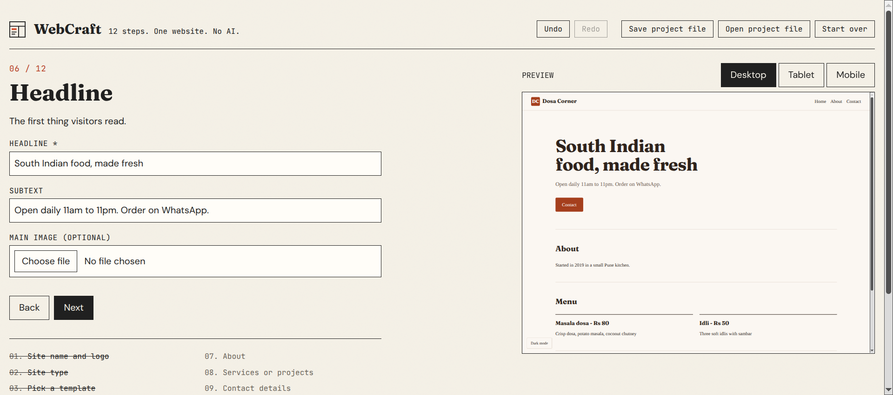

# WebCraft

A website builder that runs in the browser. You answer 12 short steps and it gives you a finished one-page site. You can preview it, download it as one HTML file or as a ZIP, or publish it to a local server.

Mini project, B.Tech. Plain HTML, CSS and JavaScript. No framework, no AI, no API calls. It works with the internet switched off.

**Live:** https://mishraxram.github.io/mini-project/



## How it works

```
answers (form)  ->  state object  ->  layout(state, theme)  ->  HTML string  ->  iframe / file
```

- Every step is one object in `js/steps.js`. One engine in `js/app.js` draws all of them.
- A theme is an object of colours, fonts, radius and spacing (`js/themes.js`, 10 themes).
- A layout is a function that returns HTML (`js/layouts.js`, 5 layouts).
- `js/templates.js` loops over layouts x themes, so the gallery has 50 templates and none were written by hand. Adding one theme adds 5 templates.

## The 12 steps

1. Site name and logo
2. Site type (portfolio, business, blog, event, restaurant, student)
3. Template, from a gallery with filters, search and a random pick
4. Colours and font style
5. Menu items (up to 6)
6. Hero headline, text and image
7. About section
8. Services or project cards (up to 6, each with an optional image)
9. Contact: email, phone, WhatsApp, address
10. Footer and social links
11. SEO title and description
12. Review, accessibility check, download or publish

## Features

- Live preview at desktop, tablet and mobile width
- Download as a single HTML file (fonts and images are embedded) or as a ZIP
- Autosave in localStorage; save and open a `webcraft-project.json` file
- Undo / redo (Ctrl+Z, Ctrl+Y)
- Image upload: PNG, JPG, SVG or WebP; photos are shrunk in the browser to stay under 500 KB
- Accessibility check before download: missing alt text, low contrast, empty links, missing description
- Generated sites have a sticky header, a mobile menu, a dark mode button, a WhatsApp / mail link and Open Graph tags

## Run it

Open `index.html` in Chrome or Edge. That is all the builder needs.

For the Publish button you need Node:

```
npm install
npm start
```

Then open http://localhost:3000. Published sites are saved in `sites/<name>/` and served at `localhost:3000/<name>`.

The GitHub Pages link above has no server, so Publish does not work there. Download and ZIP do.

## Security

- All user text goes through `escapeHTML()` before it enters an HTML string.
- Links must start with `http://` or `https://`; `javascript:` links are dropped.
- The publish name only allows `a-z`, `0-9` and `-`, so `../` and slashes cannot reach the file system.
- Opened project files are checked field by field; unknown or wrong-type fields are skipped.

The full test table is in [TESTS.md](TESTS.md). Notes on why each part was built the way it was are in [NOTES.md](NOTES.md).

## Limits

- Publishing is local only. A real public site needs a host and a domain; GitHub Pages or Netlify Drop are the next step for a downloaded site.
- One page per site. No login, no database.
